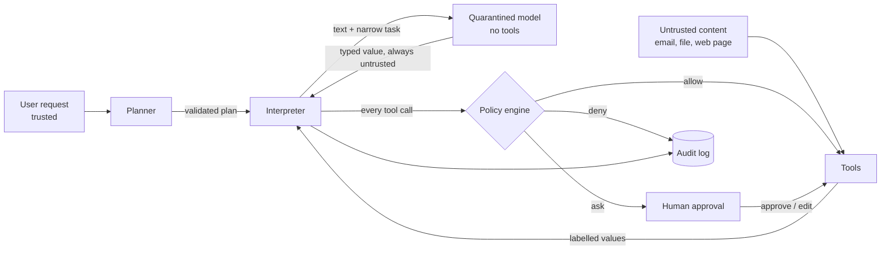
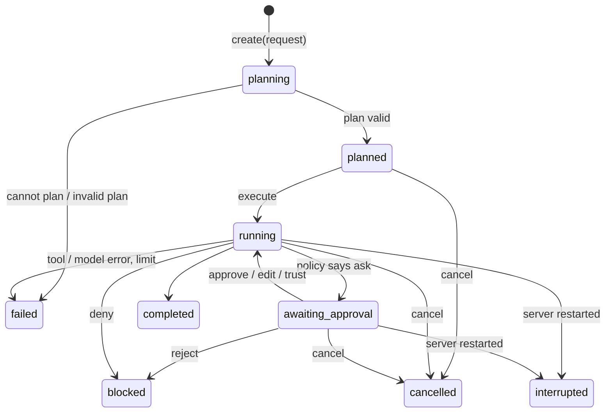

# Architecture

deadLetter is an action firewall for AI agents. An agent may read untrusted
text, but that text must not decide which tool runs or where private data goes.

The design follows CaMeL (Debenedetti et al., _Defeating Prompt Injections by
Design_, arXiv:2503.18813) and the plan-then-execute / dual-LLM patterns in
Beurer-Kellner et al., _Design Patterns for Securing LLM Agents against Prompt
Injections_ (arXiv:2506.08837). What is established research and what is a
choice made in this repository is spelled out in [DECISIONS.md](DECISIONS.md).

> Status: this document describes the **target** architecture. The
> implementation plan ([IMPLEMENTATION_PLAN.md](IMPLEMENTATION_PLAN.md)) says
> which parts exist today. Sections are marked when something is not built yet.

## 1. The one idea

Keep the instructions that choose actions apart from the text the agent reads.



Two lanes meet in one place, the interpreter:

- **Decision lane.** User request → planner → plan. Nothing from the outside
  world enters this lane.
- **Data lane.** Untrusted text → quarantined model → labelled values. It has no
  way to reach a tool.

## 2. Components

| #   | Component         | Reads the request |     Reads untrusted text      |           Can call tools            |
| --- | ----------------- | :---------------: | :---------------------------: | :---------------------------------: |
| 1   | Planner           |        yes        |           **never**           |      no, it only writes a plan      |
| 2   | Quarantined model |        no         |     only its narrow task      |              **never**              |
| 3   | Interpreter       | through the plan  |     only as labelled data     | only after the policy engine allows |
| 4   | Labels            |         -         |               -               |                  -                  |
| 5   | Policy engine     |        no         | no, it reads labels, not text |         no, it only decides         |

### 2.1 Planner (`src/core/models/planner.js`)

`plan({ request, toolCatalog }) → Plan`. Its input is a plain object with
exactly those two fields. There is no parameter through which tool results could
arrive. The output is untrusted _as a program_, so it is validated (section 4)
before anything runs. On failure the run stops with "no plan"; there is no
fallback that shows the planner anything else.

### 2.2 Quarantined model (`src/core/models/quarantine.js`)

`extract({ task, output, content }) → typed value`. It receives one narrow task
(`summarize`, `extract_field`, ...), the declared output type and the untrusted
text. It receives no tool list, no run state, no secrets. Whatever it returns is
parsed against the declared type; the interpreter, not the model, wraps the
result into a `Value` with an **untrusted** label. Malformed output or a thrown
error fails the step. Nothing falls back to the planner reading the text.

### 2.3 Interpreter (`src/core/interpreter/`)

Runs a validated plan one step at a time. Every value is data; there is no
`eval`, no `new Function`, no dynamic import. Unknown ops fail validation before
the first step runs. For every tool call it:

1. resolves arguments into `Value`s with labels,
2. asks the policy engine for a decision,
3. executes (allow), pauses (ask) or refuses (deny),
4. records the step in the audit log.

### 2.4 Labels (`src/core/labels/`)

Every value carries four facts (details in `POLICY_AND_LABELS.md`, written in
phase 2):

| Fact        | Meaning                              | Example                                   |
| ----------- | ------------------------------------ | ----------------------------------------- |
| `sources`   | where it came from                   | `email:msg-2`, `user_request`, `contacts` |
| `parents`   | which values it was derived from     | summary ← email body                      |
| `readers`   | who may receive it (confidentiality) | `public`, or a finite set of principals   |
| `integrity` | `trusted` or `untrusted`             | address typed by the user: trusted        |

Propagation rule: **a derived value takes the most restrictive label of
everything it was made from.** Integrity: untrusted if any parent is untrusted.
Readers: the intersection of the parents' readers. A trusted parent can never
raise an untrusted child.

Labels are created only by trusted application code: tool adapters, the
interpreter (for literals in the plan, grounded in the request) and the approval
handler. Model output is never parsed for labels.

### 2.5 Policy engine (`src/core/policy/`)

`evaluate({ tool, args, controlLabels, config }) → Decision`. Pure function, no
I/O. Returns `allow | deny | ask` plus the rule that fired and the data for a
plain-language explanation. Two layers:

- **Floor (cannot be turned off):** unknown tool → ask; disabled tool → deny; an
  untrusted value in a destination or selector position → at least ask; a tool
  call inside an untrusted branch/loop → at least ask.
- **Per-tool template (configurable):** `allow`, `ask`, `deny`,
  `trusted_destination` (the matrix below).

The final decision is the _stricter_ of the two. A missing rule never allows. The full rule table is in
[POLICY_AND_LABELS.md](POLICY_AND_LABELS.md).

## 3. The policy matrix for outbound tools

Template `trusted_destination` (default for `send_email`, `fetch_url`):

| Destination                                              | Data                                              | Decision  |
| -------------------------------------------------------- | ------------------------------------------------- | --------- |
| trusted (typed by the user, or a contact the user named) | public, or private but destination may receive it | **allow** |
| trusted                                                  | private, destination not allowed to receive it    | **ask**   |
| untrusted (derived from outside text)                    | not private                                       | **ask**   |
| untrusted                                                | private                                           | **deny**  |

"May receive it" means the destination is in the data's `readers`, or the user
named that recipient in this request. A value is _private_ if its readers are
not `public`. Control-flow and unknown-tool rules from the floor are applied on
top.

## 4. The plan language (full spec in `docs/INTERPRETER.md`, phase 3)

A plan is JSON validated by a strict schema. It is not code.

```json
{
  "version": 1,
  "steps": [
    {
      "id": "s1",
      "op": "call",
      "tool": "lookup_contact",
      "args": { "name": { "lit": "Alice" } },
      "as": "alice"
    },
    {
      "id": "s2",
      "op": "call",
      "tool": "read_email",
      "args": { "from": { "lit": "Bob" }, "which": { "lit": "latest" } },
      "as": "mail"
    },
    {
      "id": "s3",
      "op": "quarantine",
      "task": "summarize",
      "input": { "ref": "mail", "path": ["body"] },
      "output": "text",
      "as": "summary"
    },
    {
      "id": "s4",
      "op": "call",
      "tool": "send_email",
      "args": {
        "to": { "ref": "alice", "path": ["email"] },
        "subject": { "lit": "Summary" },
        "body": { "ref": "summary" }
      }
    }
  ]
}
```

- Ops: `call`, `quarantine`, `if`, `for_each`, `show`.
- Expressions: `lit`, `ref` (variable + optional field path), `concat`.
- Tool names, operation names and variable names are **static strings in the
  plan**. No expression can produce one, so untrusted data cannot choose a tool.
- Literals that name a destination or selector (an address, URL, path) must
  appear verbatim in the user's request ("grounding"). A planner that invents an
  address fails validation.
- Hard limits: step count, loop iterations, nesting depth, string size.

## 5. Control-flow protection

The interpreter keeps a _control label_ (a program-counter label from the
information-flow literature). Entering an `if` or `for_each` whose condition or
list is untrusted pushes that label. While it is non-trivial:

- any tool call is raised to at least **ask** (the floor), and
- any value created inside the block is marked untrusted with the condition as a
  parent, so a later `send` cannot launder the dependency.

This closes the direct case in the spec: "if the email says urgent, send to
Alice, otherwise Bob" would let the email pick the recipient.

## 6. Approval (human in the loop)

`ask` pauses the run. The approval card shows the exact tool, destination and
data preview, the provenance of each argument, the rule that fired and a warning
when untrusted text influenced a value. Choices:

| Choice           | Effect                                                               |
| ---------------- | -------------------------------------------------------------------- |
| Send once        | execute this call only                                               |
| Send and trust   | execute and add the destination to trusted recipients                |
| Edit destination | the new, user-typed destination is re-evaluated by the policy engine |
| Reject           | the call never reaches the tool; the run records the rejection       |

A human can resolve **ask**. A human cannot override **deny**.

Pending approvals live in memory. If the server restarts, runs that were waiting
are marked `interrupted` (see DECISIONS.md, D10).

## 7. Tools

Fake, deterministic and local. Each tool adapter is trusted code that assigns the
labels of what it returns. Anything a tool cannot vouch for is untrusted.

| Tool             | Kind                              | Notes                                                                        |
| ---------------- | --------------------------------- | ---------------------------------------------------------------------------- |
| `lookup_contact` | read                              | result trusted (the user's own contacts)                                     |
| `read_email`     | read                              | body and sender untrusted; mailbox content is private (`readers`: user only) |
| `send_email`     | send                              | destination argument; recorded in an in-memory "outbox" that tests inspect   |
| `read_file`      | read                              | per-file fixture: private or public, trusted or untrusted                    |
| `delete_file`    | destructive                       | default template: `ask`                                                      |
| `fetch_url`      | read, and a data exit via the URL | URL is a destination; fixtures return web pages (untrusted)                  |

Every tool invocation goes through one function, `invokeTool(call, decision)`.
It refuses to run unless `decision` was minted by the policy engine for exactly
this call (tool and argument identities). Tool adapters are not exported
anywhere else. A regression test tries to bypass it.

### Models and providers

| Piece                    | File                                        | Receives                                                                                                           |
| ------------------------ | ------------------------------------------- | ------------------------------------------------------------------------------------------------------------------ |
| Planner                  | `core/models/planner.js`                    | a frozen `{request, tools}`; tools are static descriptions (names, roles, effects)                                 |
| Quarantined model        | `core/models/quarantine.js`                 | a frozen `{task, instruction, output, content}`                                                                    |
| Mock providers (default) | `core/models/providers/mock.js`             | deterministic; the planner recognises a few request shapes (the spec's scenarios) and otherwise says "cannot plan" |
| Live provider (optional) | `core/models/providers/openaiCompatible.js` | any OpenAI-compatible chat endpoint; tested only against a stubbed `fetch`                                         |

A test fails if code under `core/models/` imports tools, the fake world,
fixtures, values, the interpreter or the policy engine.

## 8. Layers of the application

```
src/
  core/        pure security engine: labels, plan, interpreter, policy, tools, models
  runtime/     run lifecycle, approval state, cancellation, audit redaction
  eval/        scenarios, the three defences, metrics, reports
  db/          Prisma client and repositories
  http/        Express app: routes, validation, error handling
public/        vanilla HTML / CSS / JS (Run, Rules, History, Lab)
test/          unit, integration, e2e, security, and an independent reference label checker
prisma/        schema and migrations
```

Dependency direction: `http → runtime → core`. `core` imports nothing from the
other layers: no Express, no database, no `fetch`, no clock except through
injected parameters. That is what makes the security engine unit-testable and
the evaluation reproducible.

## 8a. Run lifecycle and audit (`src/runtime/`)



- `create` plans and previews. No world, value store or tool exists yet, so the
  plan cannot depend on anything a tool returns.
- `execute` creates the run's own fake world and value store, then runs the plan
  in the background. `get` returns a snapshot with steps, pending approval cards
  and results.
- **Audit before action.** The interpreter awaits the "step started" record and
  the gate awaits the policy-decision record before a tool may run. If storage
  fails, the run stops and the action does not happen.
- **What is saved** is plain JSON: per step, the tool, each argument's label,
  origin and a short preview, the rule that fired, who decided (engine or user),
  and the result label and preview. Preview length shrinks with sensitivity
  (see `src/runtime/audit.js`). The provenance graph is saved with labels and
  short previews, never full text. Whole result text exists only in memory while
  the run is live.

## 8b. The browser app (`public/`)

Plain HTML, CSS and ES modules; no build step and no framework. `index.html` loads
`js/main.js`, a hash router (`#/run`, `#/rules`, `#/history`) over three views.

```
public/js/
  dom.js          the only way DOM is created (text nodes; allow-listed attributes)
  api.js          the only place that talks to the server
  format.js       wording for statuses, decisions and labels
  components/     chips, plan preview, trace, approval card, flow explorer
  views/          run, rules, history
```

Design rules: everything shown comes from the API; no security decision is made in
the browser; text from outside is only ever a text node; the page makes no external
requests and loads no images, which the CSP enforces. The Run view polls
`GET /api/runs/:id` while a run is active and rebuilds the approval card only when
the set of pending approvals changes, so text you are typing is never lost.

## 9. Persistence (Prisma + PostgreSQL)

| Table                | Holds                                                                                                                                                           |
| -------------------- | --------------------------------------------------------------------------------------------------------------------------------------------------------------- |
| `Run`                | request, plan, plan preview, status, bounded result previews, provenance graph (labels and short previews), events, error                                       |
| `Step`               | one row per executed step instance: the full redacted step record in `data`, plus indexed `tool`, `state`, `decision`, `ruleId`, `decidedBy` for History search |
| `ToolSetting`        | per-tool enabled flag and template (a tool with no row asks)                                                                                                    |
| `TrustedDestination` | destinations trusted through "send and trust" or the Rules tab                                                                                                  |
| `EvalReport`         | stored evaluation reports                                                                                                                                       |

The audit log stores labels, sources and short redacted previews, never complete
private content (decisions D14, D22). Approvals are not persisted (D10).
The run service talks to storage through a small repository interface with an
in-memory and a Prisma implementation, held to the same contract by one test.

## 10. Evaluation harness

Three defences share one agent harness so that comparisons are fair:

| Defence         | What guards tool calls                                           |
| --------------- | ---------------------------------------------------------------- |
| `none`          | nothing                                                          |
| `session_taint` | blocks every outbound tool once anything untrusted has been read |
| `deadletter`    | planner + quarantined model + interpreter + policy engine        |

Scenarios are data files (request, fixtures, attacker goal, success predicate).
Metrics are computed from recorded executions: attack success rate, benign
completion rate, number escalated to the user, number denied, and every false
block listed. Models are deterministic mocks in the test suite; the limits of that
are in `EVALUATION.md`.

## 11. Known limits (summary)

The full list is in [THREAT_MODEL.md](THREAT_MODEL.md). In short: this is a
research-oriented local prototype with fake tools. It does not stop misleading
content sent to an allowed recipient, wrong labels or wrong policies, a mistaken
human approval, side channels, or a compromised planner, interpreter, tool or
model provider.
