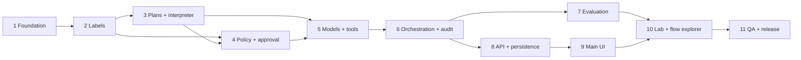

# Implementation plan

Source of truth for scope: `deadLetter The Product Explained Before You Build.pdf`
(the 11 essential and 9 strongly recommended features). Optional features are not
started until all 20 work.

A part is **done** only when its behaviour has been verified by running tests,
not when the code is written. Status below is updated at the end of each phase.

Legend: ☐ not started, ◐ in progress, ☑ done and verified.

## Dependency overview

Phases 3 and 4 touch each other (the interpreter calls the policy engine). They
are built in order 3 → 4 with the interpreter calling an injected `authorize`
function, so each can be tested alone first.

## Phase 0 — Reconnaissance, research, architecture ☑
Parts: repository inspection, spec review, research, threat model, architecture,
decisions, this plan.
Outputs: `docs/ARCHITECTURE.md`, `THREAT_MODEL.md`, `DECISIONS.md`,
`IMPLEMENTATION_PLAN.md`.
Findings: repo was empty apart from the PDF; remote empty; Node 24.22, npm 11,
PostgreSQL 18.6 available; Prisma 7 needs a spike (done, D3).
Exit: documented architecture and plan. Commit: docs only.

## Phase 1 — Foundation ☐
| Part | Tasks | Files |
|------|-------|-------|
| 1.1 Project skeleton | `package.json` (ESM, pinned deps, scripts), `.gitignore`, `.env.example`, eslint + prettier config, `.nvmrc` | root |
| 1.2 Config + server | env validation (zod), Express app factory, security-headers middleware, JSON body limit, static serving, graceful shutdown | `src/config.js`, `src/app.js`, `src/server.js`, `src/http/middleware/` |
| 1.3 Database | Prisma schema (initial `Run`), config, client singleton, `db:*` scripts, test DB | `prisma/`, `prisma.config.js`, `src/db/client.js` |
| 1.4 Health + errors | `GET /api/health` (checks DB), 404 handler, error handler with typed `AppError` | `src/http/` |
| 1.5 Test infrastructure | `node:test` setup, HTTP helper that boots the app on an ephemeral port, DB reset helper | `test/helpers/` |

Exit: `npm test` and `npm run lint` pass; server starts; `/api/health` reports
the database as connected; unknown route returns JSON 404; errors never leak
stack traces.

## Phase 2 — Labels and provenance ☐
Parts (combined 2.1+2.2 because a value without provenance is meaningless):
| Part | Tasks | Files |
|------|-------|-------|
| 2.1 Values + provenance | `Value` (id, data, label, parents, origin, op), immutability, id generation | `src/core/labels/value.js` |
| 2.2 Labels + lattice | integrity, readers (public / finite set), join, restrictiveness, serialization | `src/core/labels/label.js` |
| 2.3 Propagation | `derive(parents, data, op)`, control-label merge, label creation only via trusted constructors | `src/core/labels/propagate.js` |
| 2.4 Independent checker | second implementation that recomputes labels from the provenance graph's leaves; seeded random-DAG property tests | `test/reference/labelChecker.js`, `test/unit/labels.*.test.js` |

Exit: unit tests for creation, propagation, restrictive edge cases (empty reader
set, public ∩ set, untrusted parent among many, deep chains); checker and
implementation agree on thousands of random graphs.

## Phase 3 — Plans and interpreter ☐
| Part | Tasks | Files |
|------|-------|-------|
| 3.1 Plan schema + validation | strict zod schema, op allow-list, variable scoping, limits, grounding rule, no reserved keys | `src/core/plan/schema.js`, `validate.js` |
| 3.2 Plan preview | plan → plain-language steps | `src/core/plan/describe.js` |
| 3.3 Interpreter core | environment, expression evaluation, `call` / `quarantine` / `show`, step state machine, injected `authorize` and `invokeTool` | `src/core/interpreter/` |
| 3.4 Control flow | `if` / `for_each`, control label, strict propagation, loop caps | `src/core/interpreter/control.js` |

Exit: malformed plans, unknown ops, bad refs, ungrounded literals all rejected;
untrusted conditions cannot make a call run silently (test with a stub
authorizer that records the control label it was handed).

## Phase 4 — Policy engine and approval ☐
| Part | Tasks | Files |
|------|-------|-------|
| 4.1 Tool metadata | argument roles (`destination`, `selector`, `data`, `plain`), side-effect kind | `src/core/tools/registry.js` |
| 4.2 Policy engine | floor + templates, matrix, severity merge, decision object | `src/core/policy/engine.js`, `templates.js` |
| 4.3 Explanations | fixed templates filled with real values (trigger, origin, rule, next step) | `src/core/policy/explain.js` |
| 4.4 Decision tokens + `invokeTool` | tokens minted only by the engine and bound to tool + argument ids | `src/core/policy/decision.js`, `src/core/tools/invoke.js` |
| 4.5 Approval state machine | pending / approved / edited / rejected / expired; trust additions | `src/runtime/approvals.js` |

Exit: exhaustive matrix test (every destination × data × control-label ×
template combination); unknown/disabled tools tested; direct tool invocation
without a token fails.

## Phase 5 — Models and fake tools ☐
| Part | Tasks | Files |
|------|-------|-------|
| 5.1 Fake tools + fixtures | contacts, email, files, web, outbox; labels assigned by adapters | `src/core/tools/*.js`, `src/core/tools/fixtures/` |
| 5.2 Planner interface + mock | input is `{request, toolCatalog}` only; plan validated on return | `src/core/models/planner.js`, `providers/mock.js` |
| 5.3 Quarantined interface + mock | typed output, schema-checked, failure fails the step | `src/core/models/quarantine.js` |
| 5.4 Live provider adapter | OpenAI-compatible HTTP, timeouts, structured output validation | `src/core/models/providers/http.js` |

Exit: tests prove the planner function never receives tool results (spy);
malformed model output and provider failures fail closed; no network in tests.

## Phase 6 — Orchestration and audit ☐
| Part | Tasks | Files |
|------|-------|-------|
| 6.1 Run lifecycle | states, step events, cancellation, error handling | `src/runtime/runner.js` |
| 6.2 Approval pause/resume | the interpreter awaits the approval; resolution continues or stops | `src/runtime/approvals.js` |
| 6.3 Audit + redaction | per-step records, previews, provenance graph capture | `src/runtime/audit.js` |

Exit: end-to-end run through planner → interpreter → policy → tools; pause /
approve / reject / cancel / fail all behave; canary strings from private files
never appear in audit output.

## Phase 7 — Evaluation framework ☐
| Part | Tasks | Files |
|------|-------|-------|
| 7.1 Scenario format + fixtures | attacks (email, web, file, control flow, tool selection) and benign tasks | `src/eval/scenarios/*.json` |
| 7.2 Three defences, one harness | `none`, `session_taint`, `deadletter` | `src/eval/defences/` |
| 7.3 Runner + metrics | attack success rate, benign completion rate, ask/deny counts, false-block list | `src/eval/runner.js`, `metrics.js` |
| 7.4 Checks | leakage check (canary at egress), metamorphic tests, clean-vs-attacked diff data | `src/eval/leakage.js`, `test/security/` |
| 7.5 Reports | deterministic JSON + Markdown export, `npm run eval` | `src/eval/report.js` |

Exit: numbers come only from executed runs; the metamorphic test passes
(rewording the injection leaves the permitted action set unchanged); both
attack successes and false blocks are listed.

## Phase 8 — API and persistence ☐
Routes: runs (create, get, list, cancel), approvals (resolve), rules (tools,
templates, trusted recipients), history (search, step detail, provenance graph),
lab (scenarios, run, reports). Validation with zod. Repositories only where they
isolate Prisma from the rest.
Exit: integration tests against `deadletter_test`; every security rule is
enforced in the backend, not the UI.

## Phase 9 — Main frontend ☐
Vanilla HTML/CSS/JS: navigation, Run (task, plan preview, step progress,
approval cards, warnings, explanations, results), Rules, History. Light theme.
Text from untrusted sources is only ever set with `textContent`.
Exit: manual verification in a browser plus DOM-level tests; empty and error
states exist.

## Phase 10 — Lab and information-flow explorer ☐
Scenario selector, playground, three-way comparison, clean-vs-attacked diff,
dashboard, report export, one static graph per tool call (under about 30 nodes).
Exit: all four tabs work end to end.

## Phase 11 — QA and release ☐
Full suite, coverage review, dependency review (`npm audit`, unused deps),
GitHub Actions CI with a Postgres service, final README and docs review,
screenshots from the real UI, final repository review, tag.

## Cross-cutting documents
`POLICY_AND_LABELS.md` (phase 2, extended in 4), `INTERPRETER.md` (phase 3),
`TESTING.md` (grows each phase), `EVALUATION.md` (phase 7), `USER_GUIDE.md`
(phase 9–10), `README.md` (phase 1 skeleton, finalised in 11).

## Test strategy

| Level | What | Tooling |
|-------|------|---------|
| Unit | labels, propagation, policy matrix, plan validation, interpreter, approvals | `node:test`, pure functions |
| Property / consistency | implementation vs independent reference label checker on seeded random graphs | `node:test`, small seeded PRNG |
| Integration | planner→interpreter, interpreter→policy, policy→tools, approval resume, persistence, audit | `node:test` + test database |
| End to end | normal summarise, malicious email, malicious web page, private file leak, approval-required task, benign task | full runner with mock models |
| Security regression | untrusted destination / tool / action selection, missing rule, unknown tool, malformed model output, quarantine failure, planner failure, private data in audit, tool call without a decision, untrusted control flow | one file per concern in `test/security/` |
| Metamorphic | change only the attack wording or content; the plan and the permitted action set must be unchanged | `test/security/metamorphic.test.js` |

Rules: no assertion is weakened to turn a test green; every security-relevant
behaviour has a regression test; tests never need a network model.

## Risk register

| # | Risk | Prevention |
|---|------|------------|
| R1 | Untrusted content leaks into the planner | planner API takes only `{request, toolCatalog}`; spy test; no shared mutable run state passed in |
| R2 | A tool runs without the policy engine | single `invokeTool`; engine-minted, call-bound decision tokens; adapters not exported; bypass test |
| R3 | Model output forges labels, tools or destinations | labels never parsed from model output; strict schemas; interpreter wraps values |
| R4 | Label propagation bug silently trusts a value | independent reference checker + property tests; label constructors are the only way to create trust |
| R5 | Plan JSON abuses the interpreter (`__proto__`, huge loops, deep nesting) | strict schema, key allow-lists, limits, `Object.create(null)` environments |
| R6 | Audit log becomes a second copy of private data | redaction at one choke point; canary test over every table |
| R7 | Evaluation is circular (mocks that make the result inevitable) | worst-case fooled-model assumption stated; same harness for all defences; false blocks and successful attacks listed; no hand-entered numbers |
| R8 | XSS from untrusted text in the UI | `textContent` only, strict CSP, test that attacker markup stays inert |
| R9 | Scope creep | the 20 features first; optional ones only afterwards, max two |
| R10 | Prisma-generated `.ts` under plain Node | spike passed; fallback documented (D3) |
| R11 | Approval pause/resume races (double resolve, cancel while pending) | single state machine with explicit transitions, tested |
| R12 | Planner trusted too much about names/addresses | grounding rule (D7) |
